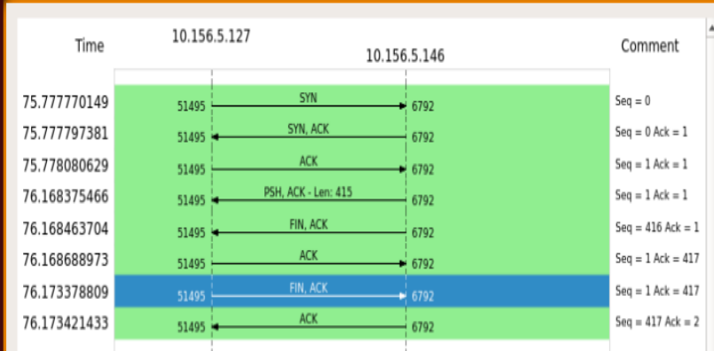
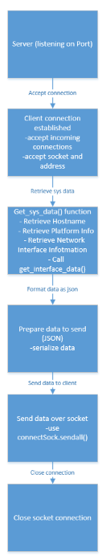
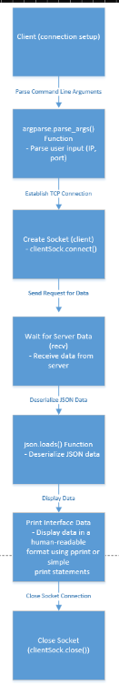
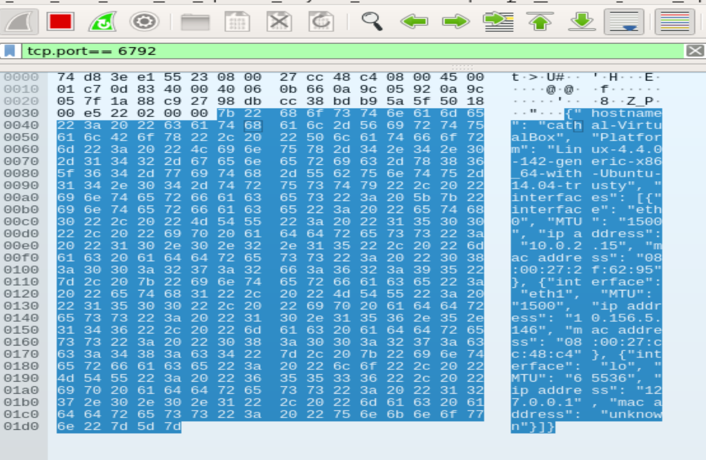

<h1 align="center">Network Interface Reporting Service</h1>

<p align="center">
  A TCP client/server pair that collects a Linux host's network interface<br>
  configuration and returns it as structured JSON.
</p>

<p align="center">
  
  
  
  
</p>

<p align="center">
  
</p>

<p align="center">
  <sub>A complete exchange captured in Wireshark — three-way handshake, a single 415-byte
  push of JSON, then a clean four-way teardown.</sub>
</p>

---

**Programming for Networks — Year 3, BTech Networking Technologies (TU716), TU Dublin, December 2024.**
Cathal Flood

---

## What it does

The server listens on a TCP port. When a client connects, it enumerates every network
interface on the host, shells out to `ifconfig` for each one, parses the output for the
values that matter, and sends the whole lot back as a single JSON document before closing
the connection.

The point of the exercise was to work at the socket layer directly — no HTTP library, no
framework — and to be able to prove what went over the wire.

- **Interface discovery** — `socket.if_nameindex()` enumerates interfaces at runtime, so
  the server adapts to whatever host it runs on rather than using a hardcoded list.
- **Structured extraction** — regular expressions pull MTU, IPv4 address and MAC address
  out of unstructured `ifconfig` text.
- **Fault isolation** — an interface that fails to parse returns `"unknown"` for its
  fields instead of taking down the response for every other interface.
- **JSON over raw sockets** — the payload is serialised, encoded and sent with
  `sendall()`, so a partial write can't silently truncate the response.

## How it works

<p align="center">
  
  &nbsp;&nbsp;&nbsp;&nbsp;
  
</p>

<p align="center"><sub>Server (left) and client (right).</sub></p>

The server holds the connection open only as long as it takes to gather and send the data,
then closes it — visible in the capture above as the `FIN, ACK` immediately following the
415-byte `PSH, ACK`. Detailed flowcharts for each side are in [`docs/`](docs/).

## Running it

The server needs `pexpect`, and expects `ifconfig` to be available:

```bash
pip install -r requirements.txt
```

Start the server on the machine you want to inspect — it binds to `0.0.0.0:6794`:

```bash
python3 server.py
```

Then query it from anywhere that can reach that port:

```bash
python3 client.py --ip 10.156.5.146 --port 6794
```

## Example output

```json
{
    "hostname": "cathal-VirtualBox",
    "Platform": "Linux-4.4.0-142-generic-x86_64-with-Ubuntu-14.04-trusty",
    "interfaces": [
        { "interface": "eth0", "MTU": "1500",  "ip address": "10.0.2.15",    "mac address": "08:00:27:2f:62:95" },
        { "interface": "eth1", "MTU": "1500",  "ip address": "10.156.5.146", "mac address": "08:00:27:cc:48:c4" },
        { "interface": "lo",   "MTU": "65536", "ip address": "127.0.0.1",    "mac address": "unknown" }
    ]
}
```

That is the response the client printed in the lab, connecting from a Windows machine to the
server on the Ubuntu VM ([`docs/client-output.png`](docs/client-output.png)). The loopback
interface has no hardware address, so it reports `unknown`.

[`examples/interface.json`](examples/interface.json) is an earlier file written by the
standalone script below. It uses the older key names (`Hostname` / `IPv4` / `MAC`), and its
MAC fields are `null` because that version's regex did not match the adapters.

## Part 1: the standalone script

Before the client/server version, the assignment's first part was a local tool.
[`standalone/get_interface_data.py`](standalone/get_interface_data.py) gathers the hostname,
platform and per-interface MTU, IPv4 and MAC, pretty-prints them, and writes them to
`interface.json`. The server reuses the same interface-parsing approach. My first attempt
split `ifconfig` output by line position and broke whenever the layout shifted; switching to
regular expressions fixed that.

## Verifying it in Wireshark

[`captures/tcp-exchange.pcapng`](captures/tcp-exchange.pcapng) is the capture of a full
exchange on the college lab network (server port 6792 in that run). Open it in Wireshark and
filter on `tcp.port == 6792`.

<p align="center">
  
</p>

<p align="center"><sub>The single <code>PSH, ACK</code> segment carries the whole JSON
document — hostname, platform and each interface — readable in the ASCII pane.</sub></p>

[`docs/wireshark-tcp-header.png`](docs/wireshark-tcp-header.png) and
[`docs/wireshark-tcp-data.png`](docs/wireshark-tcp-data.png) show the TCP header fields
(ports, relative sequence and acknowledgement numbers, flags, window size) for segments in
the same exchange.

## Report

The full assignment report — design, structure charts, flowcharts, implementation notes,
testing and TCP analysis — is in [`docs/report.pdf`](docs/report.pdf). The report notes one
limitation honestly: the brief asked for cross-platform support, and this version targets
Linux only.

## A note on `ifconfig` output

The parsing targets the **legacy net-tools format**, where `ifconfig` prints
`inet addr:10.0.2.15` and `HWaddr 08:00:27:...`. That is what shipped on the Ubuntu 14.04
lab image this was written against.

Modern distributions print `inet 10.0.2.15` with no `addr:` prefix, and report the MAC as
`ether` rather than `HWaddr` — so on a current system the IPv4 and MAC regexes fall through
to `"unknown"` while MTU still matches. Supporting both would mean widening the patterns to
accept either spelling; `iproute2` or `psutil` would be the better foundation for anything
beyond this exercise.

## Repository layout

```
server.py               TCP server - interface discovery, parsing, JSON response
client.py               CLI client - argparse, connect, receive, pretty-print
requirements.txt        pexpect
standalone/
  get_interface_data.py Part 1: local interface report written to JSON
examples/
  interface.json        Output from an earlier run of the standalone script
captures/
  tcp-exchange.pcapng   Wireshark capture of a full client-server exchange
docs/
  server-block.png      Server block diagram
  client-block.png      Client block diagram
  server-flow.png       Server flowchart
  client-flow.png       Client flowchart
  tcp-flow.png          Wireshark flow graph of a full exchange
  server-structure.png  Server structure chart
  client-structure.png  Client structure chart
  server-flow-detailed.png / client-flow-detailed.png   Second-page flowcharts
  client-output.png     Client output in the lab
  wireshark-*.png       Wireshark views of the payload and TCP header
  report.pdf            Full assignment report
```
